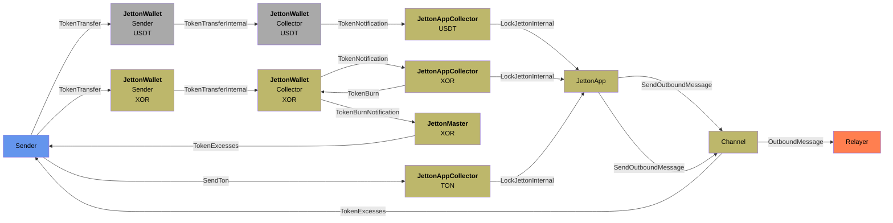

# Overview

Here is flowcharts for TON Bridge contracts. For simplicity:

* TON - TONCOIN, e.g. native currency in TON Network
* USDT - as example of external Jetton
* XOR - as example of SORA asset in TON Network

# TON Network to SORA flow

# SORA to TON Network flow

```mermaid
graph LR;
    Relayer;
    Channel;
    JettonApp;
    JettonAppCollector["`**JettonAppCollector**
    USDT`"];
    SoraJettonAppCollector["`**JettonAppCollector**
    XOR`"];
    TonJettonAppCollector["`**JettonAppCollector**
    TON`"];
    JettonAppCollectorWallet["`**JettonWallet**
    Collector
    USDT`"];
    SoraJettonMaster["`**JettonMaster**
    XOR`"];
    SoraSenderWallet["`**JettonWallet**
    Sender
    XOR`"];
    SenderWallet["`**JettonWallet**
    Sender
    USDT`"];
    Sender;

    style Sender fill:cornflowerblue,color:black;
    style Relayer fill:coral,color:black;
    style SenderWallet fill:darkgray,color:black;
    style JettonAppCollectorWallet fill:darkgray,color:black;
    style JettonAppCollector fill:darkkhaki,color:black;
    style SoraJettonAppCollector fill:darkkhaki,color:black;
    style TonJettonAppCollector fill:darkkhaki,color:black;
    style JettonApp fill:darkkhaki,color:black;
    style Channel fill:darkkhaki,color:black;
    style SoraSenderWallet fill:darkkhaki,color:black;
    style SoraJettonMaster fill:darkkhaki,color:black;
    
    %% SORA Asset to Jetton
    Relayer -- "SendInboundMessages" --> Channel;
    Channel -- "`**InboundMessageInternal**
    UnlockJetton`" --> JettonApp;
    JettonApp -- "UnlockJettonInternal" --> JettonAppCollector;
    JettonAppCollector -- "TokenTransfer" --> JettonAppCollectorWallet;
    JettonAppCollectorWallet -- "TokenTransferInternal" --> SenderWallet;
    SenderWallet -- "TokenExcesses" --> Relayer;
    SenderWallet -- "TokenNotification" --> Sender;
    Channel -- "TokenExcesses" --> Relayer;

    %% SORA Asset to SORA Jetton
    SoraJettonAppCollector -- "Mint" --> SoraJettonMaster;
    SoraJettonMaster -- "TokenTransferInternal" --> SoraSenderWallet;
    SoraSenderWallet -- "TokenNotification" --> Sender;
    JettonApp -- "UnlockJettonInternal" --> SoraJettonAppCollector;
    SoraSenderWallet -- "TokenExcesses" --> Relayer;
    
    %% TON from SORA to TON Network
    TonJettonAppCollector -- "Empty message with TON" --> Sender;
    JettonApp -- "UnlockJettonInternal" --> TonJettonAppCollector;
```

